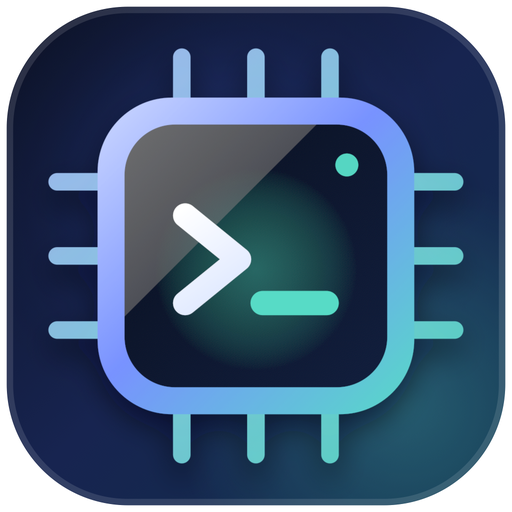
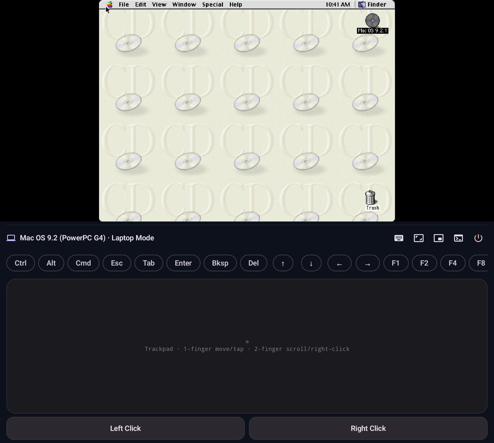
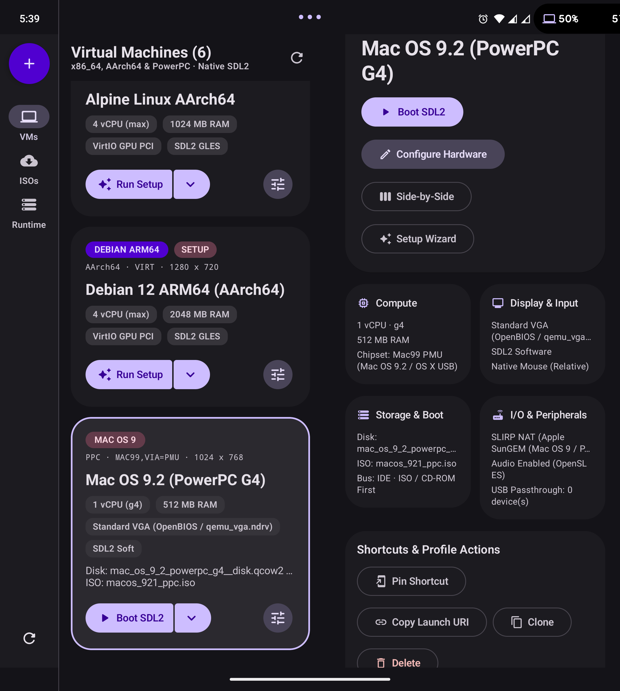
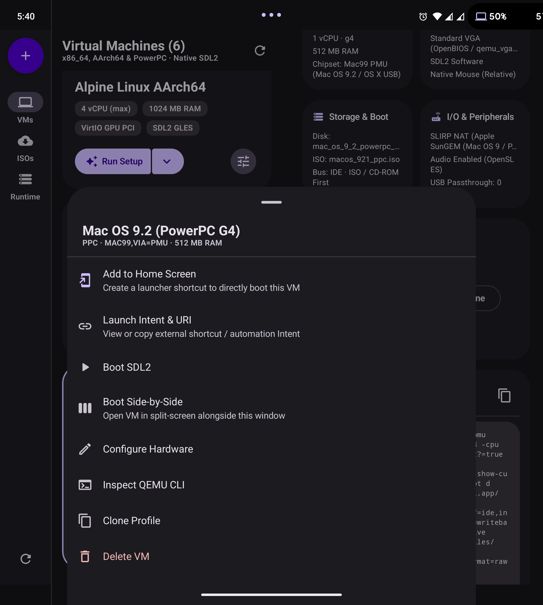
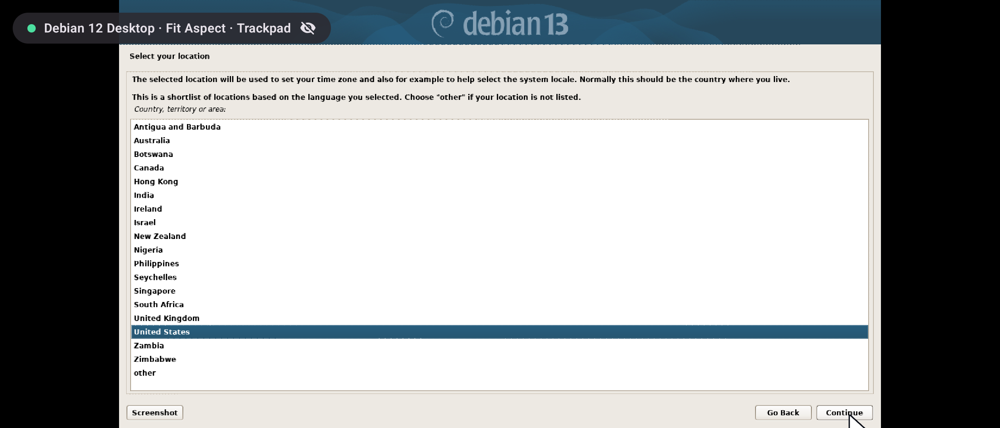
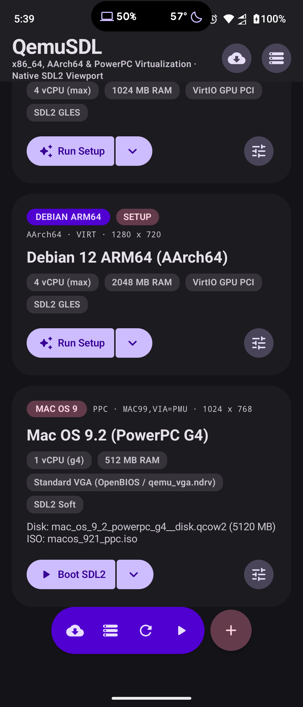
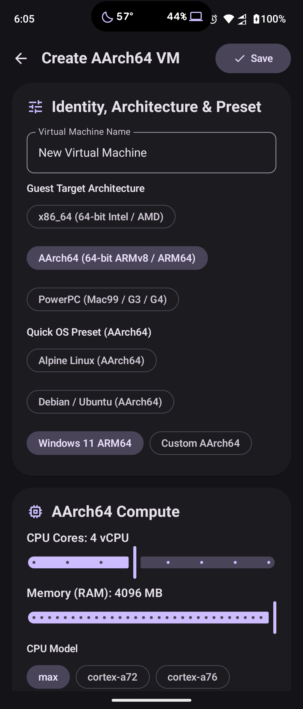
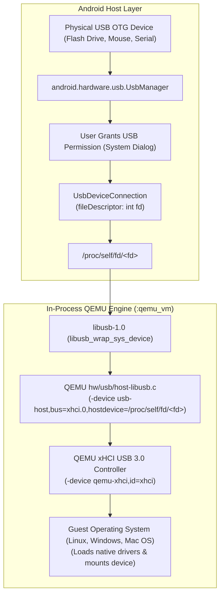
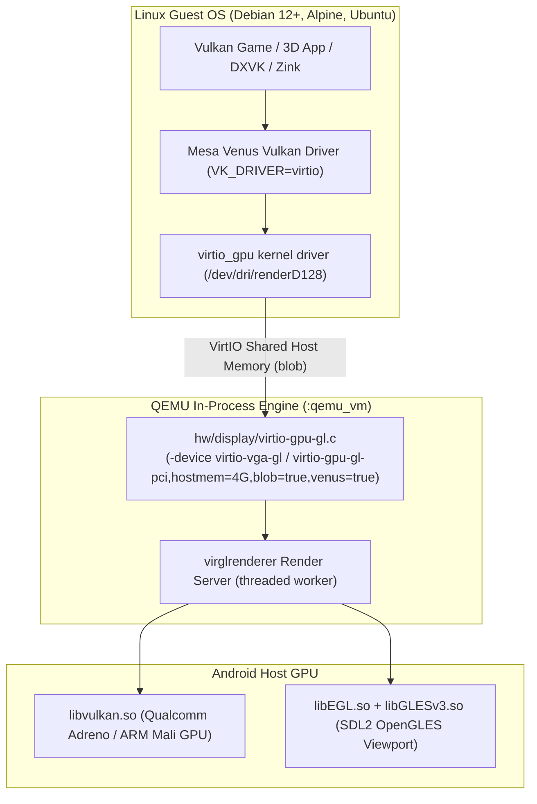
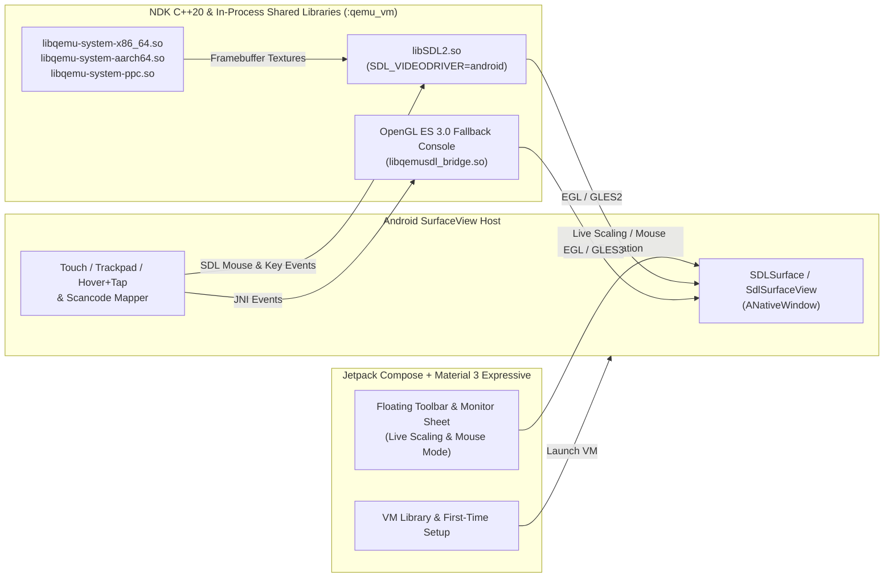

<div align="center">
  
  <h1>QemuSDL</h1>
  <p><strong>Android x86_64, AArch64 &amp; PowerPC QEMU VM Runner with Native SDL2 Viewport</strong></p>
  <p>
    
    
    
    
    
    
  </p>
  <p>
    <a href="https://apps.obtainium.imranr.dev/redirect?r=obtainium://add/https://github.com/kaikunxp/QemuSDL">
      
    </a>
    <a href="https://github.com/kaikunxp/QemuSDL/releases/latest">
      
    </a>
  </p>
</div>

> [!IMPORTANT]
> **100% Vibecoded Project**
> This entire repository—including the Android Jetpack Compose UI, Material 3 Expressive design system, Navigation 3 routing, pure-Kotlin QCOW2 v3 sparse disk generator, NDK C++20 JNI bridge, OpenGL ES 3.0 framebuffer viewport, and the NDK cross-compilation pipeline for `libSDL2.so`, `libusb-1.0.so`, `libqemu-system-x86_64.so`, `libqemu-system-aarch64.so`, and `libqemu-system-ppc.so`—was **100% vibecoded** with AI. Expect experimental architecture, rapid iteration, and zero handwritten boilerplate.

---

## Installation

- **Obtainium (Recommended for automatic updates):** [Add QemuSDL to Obtainium](https://apps.obtainium.imranr.dev/redirect?r=obtainium://add/https://github.com/kaikunxp/QemuSDL)
- **Manual APK:** Download the latest signed release APK from [GitHub Releases](https://github.com/kaikunxp/QemuSDL/releases/latest).

---

## Overview

**QemuSDL** (`com.qemusdl.app`) is an Android (API 31–36) multi-architecture virtual machine manager and runner built with **Kotlin**, **Jetpack Compose**, **Material 3 Expressive**, and an **Android NDK C++20 / OpenGL ES 3.0 + SDL2** native viewport bridge—designed to boot **x86_64**, **AArch64 (ARM64)**, and **PowerPC (Mac99 / G3 / G4)** guests directly in-process via `-display sdl` instead of VNC.

---

## Supported Guest Architectures

All three QEMU SoftMMU targets (`arm64-v8a`), `libSDL2.so`, `libusb-1.0.so`, and their required firmware ROMs are bundled out of the box:

| Architecture | QEMU Library | Machine Types | Bundled Firmware | Display Options | Built-in OS Presets & Catalog ISOs |
| :--- | :--- | :--- | :--- | :--- | :--- |
| **x86_64** | `libqemu-system-x86_64.so` | `q35`, `pc` (i440FX) | SeaBIOS, VGABIOS, iPXE ROMs | `virtio-vga`, `virtio-vga-gl` (Venus 3D), `std`, `bochs-display`, `qxl-vga`, `vmware-svga` | Alpine Linux, Debian Stable Netinst, Tiny Core Pure64, FreeDOS 1.3, Windows 10 22H2 / Windows 11 25H2 & LTSC 2024 Eval |
| **AArch64 (ARM64)** | `libqemu-system-aarch64.so` | `virt`, `sbsa-ref` | EDK2 UEFI (`edk2-aarch64-code.fd`, `edk2-arm-vars.fd`) | `virtio-gpu-pci`, `virtio-gpu-gl-pci` (Venus 3D), `ramfb`, `bochs-display` | Alpine Linux ARM64, Debian Stable arm64 Netinst, Windows 11 IoT LTSC 2024 ARM64 Eval |
| **PowerPC (PPC)** | `libqemu-system-ppc.so` | `mac99,via=pmu`, `mac99,via=pmu-adb`, `mac99` (CUDA), `g3beige` | OpenBIOS (`openbios-ppc`), `qemu_vga.ndrv`, `vgabios-ati.bin` | `std` (OpenBIOS / `qemu_vga.ndrv`), `ati-vga` (ATI Rage 128 Pro), `bochs-display` | Classic **Mac OS 9.2.1** (Internet Archive ISO), Mac OS X PowerPC, Custom PowerPC (`sungem` Ethernet) |

---

## Screenshots

### Foldable Tabletop "Mini-Laptop" Mode (Classic Mac OS 9.2.1 · PowerPC G4)

<p align="center">
  
</p>

### Adaptive Foldable &amp; Tablet Two-Pane Workspace

| Unfolded 2-Pane VM Library &amp; Inspector | Home Screen Shortcuts, Launch Intents &amp; Side-by-Side |
| :---: | :---: |
|  |  |

### Live Native SDL2 Guest Viewport (Debian x86_64 Installer)

| Interactive Floating HUD &amp; Trackpad Controls | Clean Distraction-Free SDL2 Viewport |
| :---: | :---: |
|  |  |

### Phone UI, Multi-Arch ISO Downloader &amp; VM Configurator

| Phone VM Library Dashboard (Multi-Arch) | Built-in Multi-Arch ISO Downloader |
| :---: | :---: |
|  |  |

| Architecture, OS Presets &amp; Compute | SDL2 Viewport, Venus 3D &amp; Mouse Emulation |
| :---: | :---: |
|  |  |

| Storage, QCOW2 &amp; Boot Media | USB OTG Passthrough, Networking &amp; Audio |
| :---: | :---: |
|  |  |

---

## Why Native SDL2 Instead of VNC?

Traditional Android QEMU frontends spawn QEMU with `-display vnc=127.0.0.1:0` and stream compressed tiles over localhost TCP sockets into a Java/Kotlin VNC client. **QemuSDL** eliminates that bottleneck by binding QEMU's display output directly to Android's `ANativeWindow` (`SurfaceView`) via an in-process SDL2 + OpenGL ES texture streaming pipeline:

- **Zero VNC / TCP serialization overhead** — guest frames stream straight to GPU textures (`glTexSubImage2D` / SDL2 `opengles2` renderer).
- **Live in-VM Viewport Scaling** — switch between **Fit Aspect** (letter/pillarboxed), **Fill Screen** (stretched), and **1:1 Pixel** (integer centered) on the fly from the floating toolbar or monitor sheet while the VM is running.
- **Selectable Mouse, Stylus & Desktop Pointer Support** — choose how touch interacts with the guest pointer in real time while the VM is running, alongside hardware mouse and stylus support:
  - **Trackpad (Relative)** — drag anywhere on screen for relative cursor motion with adjustable sensitivity, 1-finger tap for Left Click, 2-finger tap for Right Click, and 2-finger drag for Mouse Wheel scroll (with unbounded relative deltas for Classic Mac OS 9 `usb-mouse`/`adb-mouse`).
  - **Direct Touch (Absolute)** — tap or drag directly at the target screen coordinates to move and left-click immediately (paired with `-device usb-tablet`).
  - **Hover & Tap (Absolute)** — slide your finger to hover the guest cursor at the exact finger position without clicking, then tap with 1 finger for Left Click or 2 fingers for Right Click.
  - **First-Class Stylus Support** — air-hover cursor tracking, precision direct click/drag even while fingers stay in Trackpad mode, and barrel-button native Right-Click (Moto Pen Ultra, S Pen, USI styluses).
  - **GooglebookOS / Android Desktop Mouse & Pointer Capture** — viewport-mapped physical mouse hover & right-click, `F11` / `Alt+Enter` full-screen toggle, and `Ctrl+Alt+G` Android Pointer Capture for relative-mouse guests.
- **3-Tier Adaptive UI (Phone, Foldable/Tablet & GooglebookOS Desktop)** — preserves the compact mobile layout on phones, automatically expands to a hinge-aware Navigation Rail + Navigation 3 two-pane List-Detail workspace on unfolded foldables and tablets, and upgrades to a persistent desktop sidebar with keyboard shortcuts (`Ctrl+1/2/3`, `Ctrl+N`, `Ctrl+S`, `Ctrl+R`, `F11`, `Ctrl+Alt+G`, `Ctrl+Alt+P`), tooltips, and hover cursors on GooglebookOS / Android Desktop.
- **Foldable Superpowers** — **Tabletop "Mini-Laptop" Mode** (half-folding horizontally pins the live VM display above the crease and opens a multi-touch glass trackpad, hold-to-drag mouse buttons, and modifier/function key deck below), **Letterbox-Aware HUD Dock** (tucks controls into the unused black bar on square inner screens so zero guest pixels are covered), **Picture-in-Picture (PiP)** for running VMs, and one-tap **Side-by-Side** split-screen launch (`FLAG_ACTIVITY_LAUNCH_ADJACENT`).
- **Home Screen VM Shortcuts & Exported Launch Intents** — long-press any VM (or use the VM Inspector) to pin a launcher shortcut directly to your home screen, or trigger VMs from custom launchers, Tasker, or ADB via `qemusdl://launch/<vmId>` / `com.qemusdl.app.action.LAUNCH_VM`.
- **Direct USB OTG Host Passthrough (UsbManager + libusb)** — plug in physical USB flash drives, serial adapters, mice, keyboards, or webcams via USB-C OTG and pass them directly into the guest via Android's unprivileged `UsbDeviceConnection.getFileDescriptor()` wrapped by `libusb` / QEMU `usb-host`.
- **High-Speed xHCI USB 3.0 & Classic Mac USB/ADB Emulation** — modern `-device qemu-xhci,id=xhci` controller for x86_64/AArch64 guests alongside PMU USB / ADB input support for Classic Mac OS 9 & Mac OS X on PowerPC.
- **Native HID Keyboard & Special Keys HUD** — hardware keyboards, Android IME soft keyboards, sticky `Ctrl`/`Alt`/`Cmd` modifiers, function keys (`F1`–`F12`), arrow keys, and `Ctrl+Alt+Del` translate directly to SDL2 scancodes (`SDL_Scancode`).
- **Built-in First-Time Setup & Sleep-Resilient Multi-Arch ISO Downloader** — guided setup wizard and curated catalog covering x86_64, AArch64, and PowerPC ISOs (Alpine, Debian, Tiny Core, FreeDOS, direct Microsoft Windows 10/11 x64 & ARM64 evaluation ISOs, and Internet Archive Mac OS 9.2.1), plus custom HTTPS `.iso`/`.zip` URLs. Downloads run in a `dataSync` foreground service with partial wake/Wi-Fi locks, HTTP `Range` resume, and automatic retries so large downloads keep running reliably when the screen turns off.
- **Material 3 Expressive UI** — crafted with `MaterialExpressiveTheme`, `MotionScheme.expressive()`, dynamic wallpaper colors (Android 12+), `HorizontalFloatingToolbar`, `SplitButtonLayout`, `LoadingIndicator`, and Material 3 Adaptive Navigation 3 panes.

---

## Direct USB Passthrough Architecture (Rootless Android)

Standard Linux QEMU passes host USB devices using root access to `/dev/bus/usb/*`. On unrooted Android, apps are denied raw access to `/dev/bus/usb`. **QemuSDL** solves this natively without root:



1. **Discovery & Permissions**: The UI detects plugged-in OTG devices via `UsbManager.getDeviceList()`, displays Vendor/Product IDs and device classes (Mass Storage, HID, CDC Serial, UVC Video), and requests Android permission.
2. **Descriptor Handover**: `UsbManager.openDevice()` produces a `UsbDeviceConnection` with an open kernel `fileDescriptor`.
3. **In-Process Virtual Path**: Because `QemuSdlActivity` runs QEMU in-process, `/proc/self/fd/<fd>` points directly to the open USB character device.
4. **`libusb_wrap_sys_device()`**: QEMU's `host-libusb.c` opens the descriptor and invokes `libusb_wrap_sys_device()` to bind libusb endpoints directly to Android's open FD without requiring root.

---

## Guest Tools, Clipboard & File Sharing (VirtIO + SPICE)

QemuSDL ships full open-source VirtIO & SPICE guest integration out of the box without any proprietary dependencies:

- **One-Tap `virtio-win.iso` Drivers CD (CD-ROM #2)**: Download Fedora's signed open-source `virtio-win.iso` directly from the ISO Catalog or VM Editor and attach it automatically alongside your Windows install ISO (`VirtIO-Block`, `VirtIO-Net`, `VirtIO-GPU`, `QXL`, `VirtIO-Serial`, plus `virtio-win-guest-tools.exe`).
- **QEMU Guest Agent (`org.qemu.guest_agent.0`)**: Connects over a shared `virtio-serial-pci` controller to provide **graceful OS shutdown**, **automatic guest clock sync** on VM connect/resume, and live **OS / hostname / IP telemetry** in the Monitor Sheet.
- **Bidirectional Clipboard (`qemu-vdagent` → `com.redhat.spice.0`)**: Built into QEMU via header-only `spice-protocol` and bridged directly to Android's clipboard through SDL2 (`SDL_CLIPBOARDUPDATE` + focus re-sync) — works with `spice-vdagent` on Linux and `virtio-win-guest-tools.exe` on Windows.
- **Dynamic Guest Display Auto-Resize**: Opt-in per-VM auto-resize (`QEMU_SDL_AUTO_RESIZE`) automatically requests an aspect-preserving, 8 px-aligned guest mode (capped at 1600 px for smooth TCG performance) when rotating, unfolding, or resizing the window.
- **Host ↔ Guest Shared Folders (WebDAV/HTTP + VirtIO-9p)**:
  - **WebDAV / HTTP (`http://10.0.2.2:<port>/`)**: Universal localhost-only file server (supports browser drag-and-drop upload/download and WebDAV network drive mounting across Windows, Linux, and retro guests).
  - **VirtIO-9p (`hostshare`)**: Native zero-network Linux kernel mount (`mount -t 9p -o trans=virtio,version=9p2000.L hostshare /mnt/host`), with a 1-tap mount command helper in the Monitor Sheet.

---

## Hardware 3D GPU Acceleration: Venus Vulkan Protocol

Traditional virtual machine acceleration relies on desktop OpenGL translation (`virgl`), which struggles on mobile because Android does not provide desktop `libGL.so`. **QemuSDL** implements the **Venus Vulkan protocol** (`virglrenderer` v1.0+ with `venus=true`) for x86_64 (`virtio-vga-gl`) and AArch64 (`virtio-gpu-gl-pci`) guests:



- **Zero OpenGL Emulation Overhead**: Vulkan API commands from the guest pass directly through to Android's native `libvulkan.so` (Adreno / Mali driver).
- **Direct3D & Windows Games via DXVK**: Direct3D 9/10/11 games run inside the guest translated to Vulkan by DXVK, which Venus executes natively on the host GPU.
- **Configurable Host Memory Window**: Adjust host blob memory (`hostmem=1G` to `hostmem=8G`) directly from the VM Editor.
- **How to verify in guest**: Run `vulkaninfo` or `vkcube` inside Debian/Ubuntu/Alpine; the device name will report the Android device's real hardware GPU.

---

## Architecture & Pipeline



---

## Live In-VM Controls (Floating Toolbar & Monitor Sheet)

While a virtual machine is running in either the full native `QemuSdlActivity` (`:qemu_vm` process) or `VmViewportActivity`, you can customize the display and pointer behavior without restarting the guest:

| Control | Options | Description |
| :--- | :--- | :--- |
| **Mouse Emulation Mode** | `Trackpad (Relative)` / `Direct Touch (Absolute)` / `Hover & Tap (Absolute)` | Switch pointer emulation directly from the floating toolbar mouse button or the VM Monitor bottom sheet. Includes a live **Trackpad Sensitivity** slider (`0.5x` – `3.0x`). |
| **Viewport Scaling Mode** | `Fit Aspect` / `Fill Screen` / `1:1 Pixel` | Resize and scale the active SDL2 / OpenGL ES surface immediately via the aspect-ratio toolbar button or monitor sheet. |
| **Special Keys Bar** | `Ctrl`, `Alt`, `Esc`, `Tab`, `Super`, `↑↓←→`, `F1`–`F12`, `Ctrl+Alt+Del` | Expandable pill bar above the floating toolbar for sending modifier combinations and BIOS/OpenBIOS/UEFI hotkeys. |
| **Soft Keyboard** | Android IME | Summons the system soft keyboard and streams typed characters directly as SDL2 key events. |
| **Picture-in-Picture (PiP)** | Toolbar / `Ctrl+Alt+P` | Shrinks the running VM into a clean floating live thumbnail while you use other apps or download ISOs, then tap to return full-screen. |
| **Tabletop Mini-Laptop Mode** | Half-fold horizontally | Automatically pins the guest display above the crease and opens a dedicated glass trackpad, hold-to-drag mouse buttons, and modifier/function key deck below. |
| **Pointer Capture & Full Screen** | `Ctrl+Alt+G` / `F11` | Locks a physical laptop mouse for relative-pointer guests (such as Classic Mac OS 9) and toggles true full-screen on GooglebookOS / Android Desktop. |

---

## Project Structure

```text
.
├── app/src/main/
│   ├── assets/qemu-firmware/          # SeaBIOS, VGABIOS, iPXE, EDK2 UEFI (AArch64), OpenBIOS (PPC), qemu_vga.ndrv & keymaps (-L)
│   ├── cpp/
│   │   ├── CMakeLists.txt             # NDK C++20 (-O3 in release) build for libqemusdl_bridge.so
│   │   ├── qemu_sdl_bridge.cpp        # JNI runtime prober, ELF inspector & multi-arch bridge lifecycle
│   │   └── sdl_viewport_renderer.*    # 60 Hz EGL / OpenGL ES 3.0 interactive fallback viewport
│   ├── java/org/libsdl/app/           # SDL2 Android Java bindings with scaling, mouse, stylus & pointer capture
│   ├── jniLibs/arm64-v8a/             # Bundled -O3 stripped libSDL2.so, libusb-1.0.so & libqemu-system-{x86_64,aarch64,ppc}.so
│   └── kotlin/com/qemusdl/app/
│       ├── data/                      # GuestArchitecture, VmConfig, SdlScalingMode, MouseEmulationMode, VmRepository
│       ├── qemu/                      # QemuCommandBuilder (-display sdl), QemuGuestAgentClient, GuestSharedFolderServer, IsoDownloader, DiskImageCreator
│       ├── sdl/                       # NativeQemuBridge, SdlSurfaceView, SdlScancodeMapper
│       └── ui/
│           ├── adaptive/              # 3-tier form factor resolver (Phone / Foldable-Tablet / GooglebookOS Desktop), tooltips & hover cursors
│           ├── editor/                # Multi-arch hardware, firmware, display & mouse emulation configurator
│           ├── isos/                  # Curated x86_64, AArch64 & PowerPC ISO catalog & sleep-safe downloader
│           ├── library/               # Material 3 Expressive dashboard, 2-pane VM Inspector & pinned shortcut manager
│           ├── runtime/               # Native .so inspector, SAF importer & virtual disk manager
│           ├── setup/                 # Guided first-time VM setup wizard
│           └── viewport/              # QemuSdlActivity, TabletopLaptopDeck, FoldableViewportHelper, VmLauncherActivity & VmViewportScreen
└── scripts/
    └── build-sdl2-qemu-android.sh     # Automated -O3 NDK cross-compiler for SDL2, libusb, GLib, Pixman, Slirp & QEMU (x86_64/aarch64/ppc)
```

---

## Building & Running

### 1. Build and Test the Release APK

```bash
./gradlew :app:testReleaseUnitTest :app:assembleRelease -PtargetAbis=arm64-v8a
```

Release builds use R8 minification, resource shrinking, and `-O3` native compilation. Out of the box, QemuSDL bundles firmware for all three architectures (`bios-256k.bin`, `edk2-aarch64-code.fd`, `edk2-arm-vars.fd`, `openbios-ppc`, `qemu_vga.ndrv`, `vgabios-*.bin`, `efi-*.rom`, keymaps) and boots either:
- **In-Process QEMU (`QemuSdlActivity`)** when `libSDL2.so` and the target architecture's `libqemu-system-{x86_64,aarch64,ppc}.so` are present for the device ABI (`arm64-v8a` bundled), or
- **Interactive GLES3 SDL2 Console (`VmViewportActivity`)** as an instant 60 Hz fallback for testing viewport scaling, mouse emulation modes, and keyboard scancodes on any ABI.

### 2. Cross-Compiling Native Libraries from Source

If you want to rebuild `libSDL2.so`, `libusb-1.0.so`, and all three QEMU SoftMMU shared libraries (`libqemu-system-x86_64.so`, `libqemu-system-aarch64.so`, `libqemu-system-ppc.so`) from upstream source with the Android NDK:

```bash
./scripts/build-sdl2-qemu-android.sh --abi=arm64-v8a
```

The script automatically downloads, patches, cross-compiles with `-O3` release optimizations, and strips `libffi`, `pcre2`, `glib2`, `pixman`, `libslirp`, `libusb`, `SDL2`, and QEMU (`x86_64-softmmu,aarch64-softmmu,ppc-softmmu` with `--enable-sdl --disable-vnc`), installing the resulting `.so` binaries and firmware blobs directly into `app/src/main/`.

---

## Vibe Coding Disclaimer


This project was **vibecoded end-to-end**. Every Kotlin screen, C++ JNI bridge, OpenGL shader, and NDK build script was generated through conversational AI prompting. Feel free to fork, remix, and keep the vibes going!
