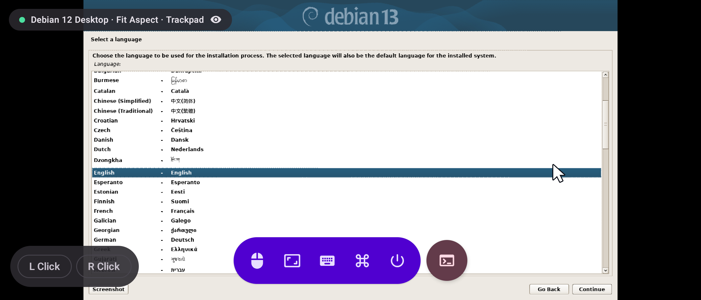
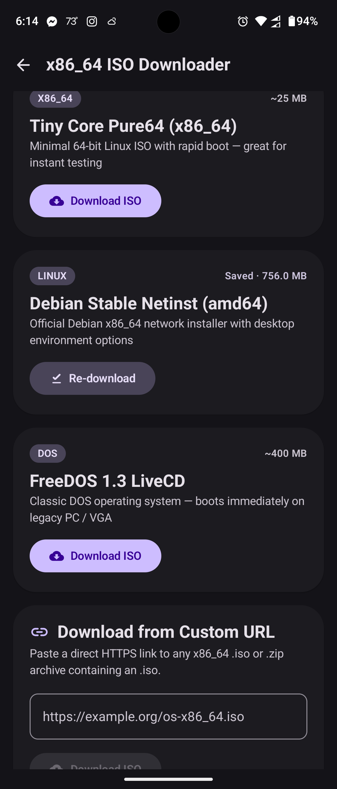
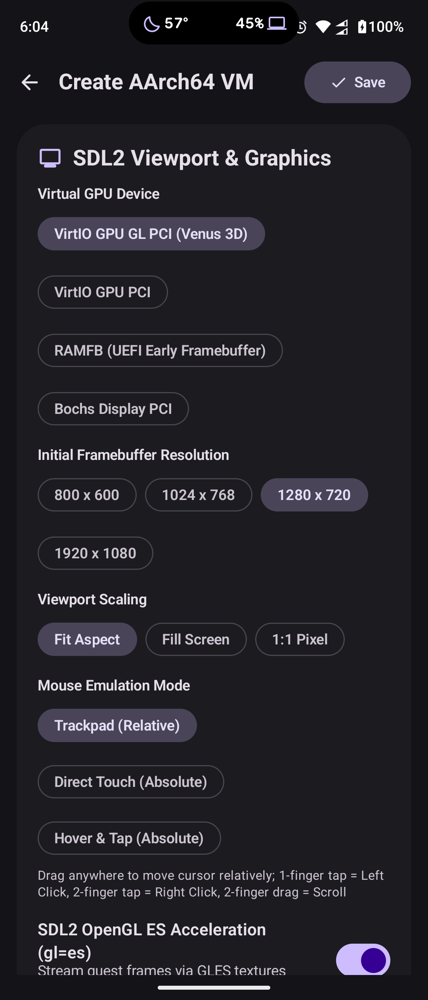
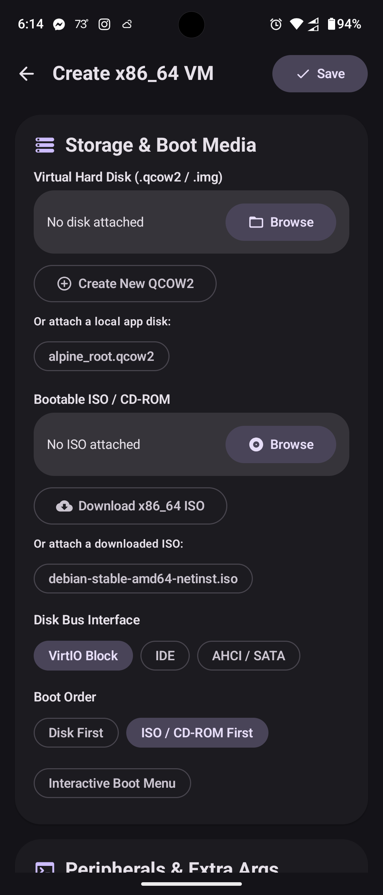
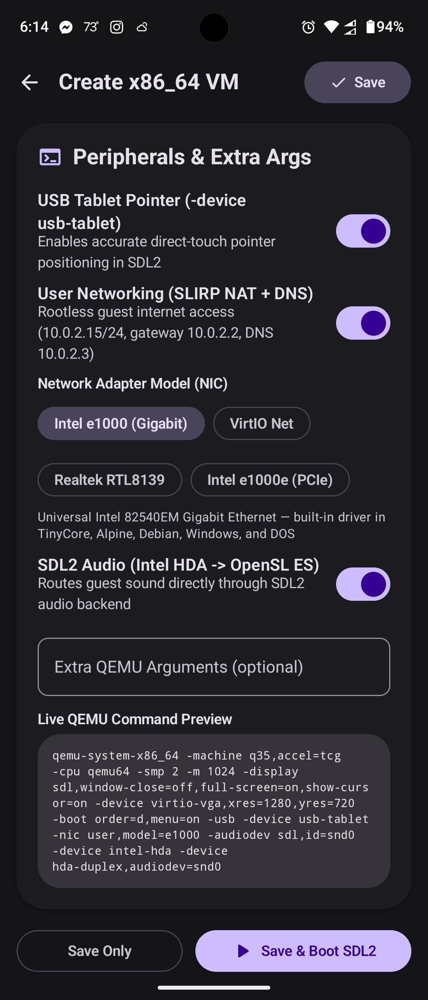
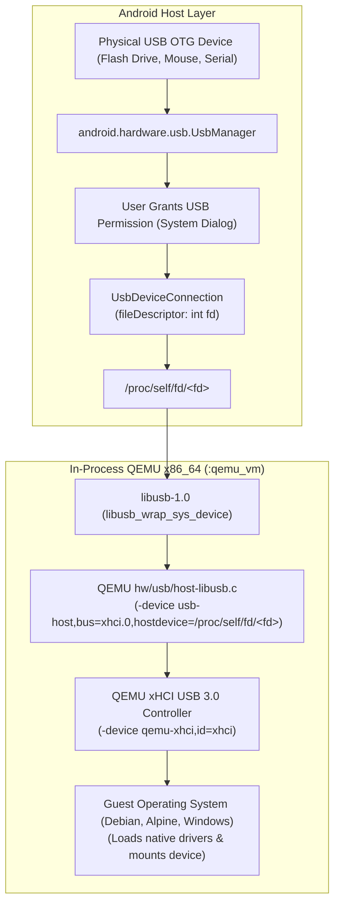
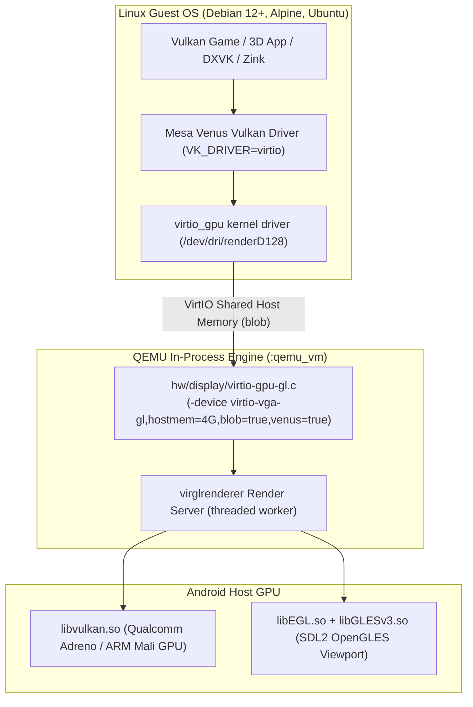
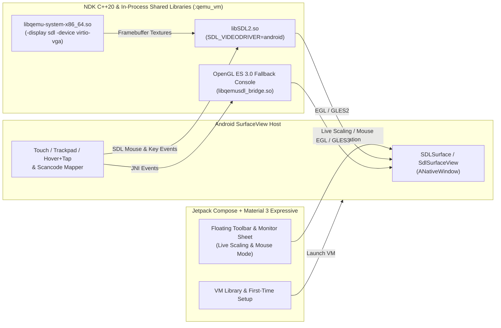

# QemuSDL — Android x86_64 QEMU VM Runner with Native SDL2 Viewport


> [!IMPORTANT]
> **100% Vibecoded Project**
> This entire repository—including the Android Jetpack Compose UI, Material 3 Expressive design system, Navigation 3 routing, pure-Kotlin QCOW2 v3 sparse disk generator, NDK C++20 JNI bridge, OpenGL ES 3.0 framebuffer viewport, and the NDK cross-compilation pipeline for `libSDL2.so` + `libqemu-system-x86_64.so`—was **100% vibecoded** with AI. Expect experimental architecture, rapid iteration, and zero handwritten boilerplate.

---

## Overview

**QemuSDL** (`com.qemusdl.app`) is an Android (API 31–36) virtual machine manager and runner built with **Kotlin**, **Jetpack Compose**, **Material 3 Expressive**, and an **Android NDK C++20 / OpenGL ES 3.0 + SDL2** native viewport bridge—designed to boot `qemu-system-x86_64` directly in-process via `-display sdl` instead of VNC.

---

## Screenshots

### Live Native SDL2 Guest Viewport (Debian x86_64 Installer)

| Interactive Floating HUD & Trackpad Controls | Clean Distraction-Free SDL2 Viewport |
| :---: | :---: |
|  |  |

### Material 3 Expressive VM Library, ISO Downloader & Configurator

| VM Library Dashboard | Built-in x86_64 ISO Downloader |
| :---: | :---: |
|  |  |

| SDL2 Viewport, Scaling & Mouse Emulation | Storage, QCOW2 & Boot Media | Networking, Audio & Live QEMU CLI |
| :---: | :---: | :---: |
|  |  |  |

---

## Why Native SDL2 Instead of VNC?

Traditional Android QEMU frontends spawn QEMU with `-display vnc=127.0.0.1:0` and stream compressed tiles over localhost TCP sockets into a Java/Kotlin VNC client. **QemuSDL** eliminates that bottleneck by binding QEMU's display output directly to Android's `ANativeWindow` (`SurfaceView`) via an in-process SDL2 + OpenGL ES texture streaming pipeline:

- **Zero VNC / TCP serialization overhead** — guest frames stream straight to GPU textures (`glTexSubImage2D` / SDL2 `opengles2` renderer).
- **Live in-VM Viewport Scaling** — switch between **Fit Aspect** (letter/pillarboxed), **Fill Screen** (stretched), and **1:1 Pixel** (integer centered) on the fly from the floating toolbar or monitor sheet while the VM is running.
- **Selectable Mouse & Touch Emulation** — choose how touch interacts with the guest pointer in real time while the VM is running:
  - **Trackpad (Relative)** — drag anywhere on screen for relative cursor motion with adjustable sensitivity, 1-finger tap for Left Click, 2-finger tap for Right Click, and 2-finger drag for Mouse Wheel scroll.
  - **Direct Touch (Absolute)** — tap or drag directly at the target screen coordinates to move and left-click immediately (paired with `-device usb-tablet`).
  - **Hover & Tap (Absolute)** — slide your finger to hover the guest cursor at the exact finger position without clicking, then tap with 1 finger for Left Click or 2 fingers for Right Click.
- **Direct USB OTG Host Passthrough (UsbManager + libusb)** — plug in physical USB flash drives, serial adapters, mice, keyboards, or webcams via USB-C OTG and pass them directly into the x86_64 guest via Android's unprivileged `UsbDeviceConnection.getFileDescriptor()` wrapped by `libusb` / QEMU `usb-host`.
- **High-Speed xHCI USB 3.0 Emulation** — modern `-device qemu-xhci,id=xhci` controller providing high-speed USB 2.0 and 3.0 ports for the guest OS alongside absolute USB tablet pointer tracking.
- **Native HID Keyboard & Special Keys HUD** — hardware keyboards, Android IME soft keyboards, sticky `Ctrl`/`Alt` modifiers, function keys (`F1`–`F12`), arrow keys, and `Ctrl+Alt+Del` translate directly to SDL2 scancodes (`SDL_Scancode`).
- **Built-in First-Time Setup & Official x86_64 ISO Downloader** — guided setup wizard that downloads official bootable x86_64 ISOs (Alpine Linux, Debian 12 Netinst, FreeDOS 1.3, Ubuntu, TinyCore, SystemRescue) and creates sparse QCOW2 v3 virtual disks automatically.
- **Material 3 Expressive UI** — crafted with `MaterialExpressiveTheme`, `MotionScheme.expressive()`, dynamic wallpaper colors (Android 12+), `HorizontalFloatingToolbar`, `SplitButtonLayout`, `LoadingIndicator`, and adaptive phone/tablet grids.

---

## Direct USB Passthrough Architecture (Rootless Android)

Standard Linux QEMU passes host USB devices using root access to `/dev/bus/usb/*`. On unrooted Android, apps are denied raw access to `/dev/bus/usb`. **QemuSDL** solves this natively without root:



1. **Discovery & Permissions**: The UI detects plugged-in OTG devices via `UsbManager.getDeviceList()`, displays Vendor/Product IDs and device classes (Mass Storage, HID, CDC Serial, UVC Video), and requests Android permission.
2. **Descriptor Handover**: `UsbManager.openDevice()` produces a `UsbDeviceConnection` with an open kernel `fileDescriptor`.
3. **In-Process Virtual Path**: Because `QemuSdlActivity` runs QEMU in-process, `/proc/self/fd/<fd>` points directly to the open USB character device.
4. **`libusb_wrap_sys_device()`**: QEMU's `host-libusb.c` opens the descriptor and invokes `libusb_wrap_sys_device()` to bind libusb endpoints directly to Android's open FD without requiring root.

---

## Hardware 3D GPU Acceleration: Venus Vulkan Protocol

Traditional virtual machine acceleration relies on desktop OpenGL translation (`virgl`), which struggles on mobile because Android does not provide desktop `libGL.so`. **QemuSDL** implements the **Venus Vulkan protocol** (`virglrenderer` v1.0+ with `venus=true`):



- **Zero OpenGL Emulation Overhead**: Vulkan API commands from the guest pass directly through to Android's native `libvulkan.so` (Adreno / Mali driver).
- **Direct3D & Windows Games via DXVK**: Direct3D 9/10/11 games run inside the guest translated to Vulkan by DXVK, which Venus executes natively on the host GPU.
- **Configurable Host Memory Window**: Adjust host blob memory (`hostmem=1G` to `hostmem=8G`) directly from the VM Editor.
- **How to verify in guest**: Run `vulkaninfo` or `vkcube` inside Debian/Ubuntu/Alpine; the device name will report the Android device's real hardware GPU.

---

## Architecture & Pipeline



---

## Live In-VM Controls (Floating Toolbar & Monitor Sheet)

While a virtual machine is running in either the full native `QemuSdlActivity` (`:qemu_vm` process) or `VmViewportActivity`, you can customize the display and pointer behavior without restarting the guest:

| Control | Options | Description |
| :--- | :--- | :--- |
| **Mouse Emulation Mode** | `Trackpad (Relative)` / `Direct Touch (Absolute)` / `Hover & Tap (Absolute)` | Switch pointer emulation directly from the floating toolbar mouse button or the VM Monitor bottom sheet. Includes a live **Trackpad Sensitivity** slider (`0.5x` – `3.0x`). |
| **Viewport Scaling Mode** | `Fit Aspect` / `Fill Screen` / `1:1 Pixel` | Resize and scale the active SDL2 / OpenGL ES surface immediately via the aspect-ratio toolbar button or monitor sheet. |
| **Special Keys Bar** | `Ctrl`, `Alt`, `Esc`, `Tab`, `Super`, `↑↓←→`, `F1`–`F12`, `Ctrl+Alt+Del` | Expandable pill bar above the floating toolbar for sending modifier combinations and BIOS/bootloader hotkeys. |
| **Soft Keyboard** | Android IME | Summons the system soft keyboard and streams typed characters directly as SDL2 key events. |

---

## Project Structure

```text
.
├── app/src/main/
│   ├── assets/qemu-firmware/          # Bundled SeaBIOS, VGABIOS, iPXE ROMs & QEMU keymaps (-L)
│   ├── cpp/
│   │   ├── CMakeLists.txt             # NDK C++20 build for libqemusdl_bridge.so
│   │   ├── qemu_sdl_bridge.cpp        # JNI runtime prober, ELF inspector & bridge lifecycle
│   │   └── sdl_viewport_renderer.*    # 60 Hz EGL / OpenGL ES 3.0 interactive fallback viewport
│   ├── java/org/libsdl/app/           # SDL2 Android Java bindings with custom scaling & mouse modes
│   ├── jniLibs/arm64-v8a/             # Prebuilt/cross-compiled libSDL2.so & libqemu-system-x86_64.so
│   └── kotlin/com/qemusdl/app/
│       ├── data/                      # VmConfig, SdlScalingMode, MouseEmulationMode, VmRepository
│       ├── qemu/                      # QemuCommandBuilder (-display sdl), IsoDownloader, DiskImageCreator
│       ├── sdl/                       # NativeQemuBridge, SdlSurfaceView, SdlScancodeMapper
│       └── ui/
│           ├── editor/                # Full x86_64 hardware, display & mouse emulation configurator
│           ├── isos/                  # Built-in official x86_64 ISO catalog & downloader
│           ├── library/               # Material 3 Expressive dashboard with SplitButtonLayout
│           ├── runtime/               # Native .so inspector, SAF importer & virtual disk manager
│           ├── setup/                 # Guided first-time VM setup wizard
│           └── viewport/              # QemuSdlActivity & VmViewportScreen with live HUD controls
└── scripts/
    └── build-sdl2-qemu-android.sh     # Automated NDK cross-compiler for SDL2, GLib, Pixman, Slirp & QEMU
```

---

## Building & Running

### 1. Build and Run the Android App

```bash
./gradlew assembleDebug testDebugUnitTest
```

Out of the box, QemuSDL includes pre-packaged firmware (`bios-256k.bin`, `vgabios-stdvga.bin`, `vgabios-virtio.bin`, `efi-virtio.rom`, keymaps) and boots either:
- **In-Process QEMU x86_64 (`QemuSdlActivity`)** when `libSDL2.so` and `libqemu-system-x86_64.so` are present for the device ABI (`arm64-v8a` bundled), or
- **Interactive GLES3 SDL2 Console (`VmViewportActivity`)** as an instant 60 Hz fallback for testing viewport scaling, mouse emulation modes, and keyboard scancodes on any ABI.

### 2. Cross-Compiling `libSDL2.so` & `libqemu-system-x86_64.so` from Source

If you want to rebuild `libSDL2.so` and `libqemu-system-x86_64.so` from upstream source with the Android NDK:

```bash
./scripts/build-sdl2-qemu-android.sh --abi=arm64-v8a
```

The script automatically downloads, patches, and cross-compiles `libffi`, `pcre2`, `glib2`, `pixman`, `libslirp`, `SDL2`, and `qemu-system-x86_64` (`--enable-sdl --disable-vnc`) into a single self-contained shared library and installs the resulting `.so` binaries and firmware blobs directly into `app/src/main/`.

---

## Vibe Coding Disclaimer

This project was **vibecoded end-to-end**. Every Kotlin screen, C++ JNI bridge, OpenGL shader, and NDK build script was generated through conversational AI prompting. Feel free to fork, remix, and keep the vibes going!
